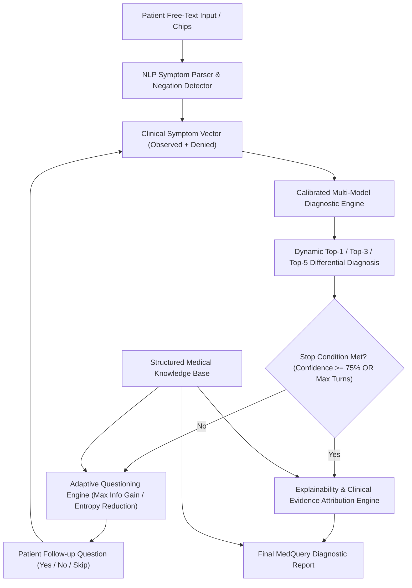

# MedQuery: An Adaptive Evidence-Guided Framework for Interactive Medical Differential Diagnosis

[](https://www.python.org/)
[](https://streamlit.io/)
[](LICENSE)
[]()

> **Major Project (Phase-I)**  
> **Degree:** Bachelor of Technology in Computer Science and Engineering (Session 2026–27)  
> **Institution:** School of Computer Science and Engineering, IILM University, Greater Noida  
> **Project Team:**  
> - **Sahil Sharma** (Roll No: 2410030764)  
> - **Ram Awasthi** (Roll No: 2410030771)  
> - **Komal Agarwal** (Roll No: 2410030596)  
> - **Harshita Goyal** (Roll No: 2410030597)  
> **Faculty Guide:** **Mr. Sushant Kumar**, Assistant Professor, SCSE, IILM University  

---

## 📌 1. Project Overview & Problem Statement

Artificial Intelligence (AI) holds strong potential in clinical decision support. However, conventional symptom-based AI models suffer from critical limitations:
1. **Incomplete Patient Information:** Patients often present only 1–2 vague or initial symptoms, causing single-turn classifiers to produce high uncertainty or misdiagnosis.
2. **Lack of Differential Diagnosis:** Standard classifiers often emit a single top disease label without probabilistic ranking across competing clinical entities.
3. **Black-Box Opacity:** Predictions rarely provide transparent clinical evidence indicating *why* a disease is suspected and which hallmark symptoms are missing.

**MedQuery** addresses these gaps through an **Adaptive Evidence-Guided Framework**:
- **Objective 1:** An interactive, conversational mechanism that dynamically selects and asks targeted follow-up questions to collect missing symptoms.
- **Objective 2:** A dynamic differential-diagnosis engine that continuously ranks and updates candidate diseases (Top-1, Top-3, Top-5) with calibrated posterior probabilities.
- **Objective 3:** Explainable and uncertainty-aware diagnostics highlighting confirmed hallmark evidence, missing symptoms, clinical urgency triage, and Shannon entropy.
- **Objective 4:** Integrated medical knowledge base covering 41 clinical conditions with precautions, warning signs, and specialist referrals.

---

## 🏗️ 2. System Architecture



---

## 📊 3. Experimental Benchmarks & Evaluation

Evaluated on the held-out test dataset (42 clinical cases across 41 conditions) and evaluated under simulated incomplete patient presentations:

### Standard Held-Out Test Performance
| Metric | Performance |
| :--- | :---: |
| **Top-1 Accuracy** | **97.62%** |
| **Top-3 Accuracy** | **97.62%** |
| **Top-5 Accuracy** | **100.00%** |
| **Macro Precision** | **98.78%** |
| **Macro Recall** | **98.78%** |
| **Macro F1-Score** | **98.37%** |
| **Weighted F1-Score** | **98.37%** |

### Adaptive Questioning Progression (Incomplete Initial Symptoms)
Simulating real-world scenarios where patients present only **1 initial symptom**:

| Consultation Step | Top-1 Accuracy | Top-3 Accuracy | Differential Entropy (Bits) |
| :--- | :---: | :---: | :---: |
| **Initial Incomplete Presentation** | 50.0% | 76.2% | 4.465 |
| **After Question 1** | 54.8% | 81.0% | 4.215 |
| **After Question 2** | 59.5% | 81.0% | 3.812 |
| **After Question 3** | 59.5% | 81.0% | 3.516 |
| **After Question 4** | **61.9%** | **83.3%** | **3.222** |

> 💡 **Empirical Finding:** Adaptive follow-up questioning achieved a **+11.9% absolute increase in Top-1 accuracy** and reduced diagnostic uncertainty (entropy) from **4.465 to 3.222 bits** within 4 targeted questions.

---

## 📁 4. Project Directory Structure

```
MedQuery/
├── data/
│   ├── raw/
│   │   ├── Training.csv              # Raw clinical dataset (4,920 cases, 131 symptoms)
│   │   └── Testing.csv               # Held-out clinical validation set (42 cases)
│   └── processed/
│       ├── cleaned_train.csv         # Cleaned, standardized training matrix
│       ├── cleaned_test.csv          # Standardized test set
│       ├── symptom_metadata.json     # Symptom lexicon & disease frequency profiles
│       └── evaluation_results.json   # Benchmark metrics & simulation history
├── models/
│   └── medquery_model.pkl            # Trained ensemble diagnostic engine
├── src/
│   ├── __init__.py
│   ├── data_processor.py             # Data normalization, cleaning & feature engineering
│   ├── knowledge_base.py             # Medical knowledge graph (41 conditions, triage, precautions)
│   ├── nlp_parser.py                 # Conversational symptom extractor with negation detection
│   ├── diagnostic_engine.py          # Calibrated multi-class differential diagnostic model
│   ├── adaptive_questioner.py        # Information Gain / entropy-driven follow-up engine
│   ├── explainability.py             # Supporting hallmark evidence & uncertainty attribution
│   └── evaluation.py                 # Top-K accuracy, precision, recall, F1, and simulation test
├── app.py                            # Interactive Streamlit Web Application
├── cli.py                            # Interactive Console / Terminal Assistant
├── train.py                          # Training pipeline and artifact generation script
├── evaluate.py                       # Standalone benchmark verification script
├── requirements.txt                  # Python dependencies
├── .gitignore
└── README.md                         # Project documentation
```

---

## 🚀 5. How to Run and Use MedQuery

### Prerequisites
Make sure Python 3.10+ (or Anaconda) is installed.

### Step 1: Clone the Repository
```bash
git clone https://github.com/komalagrawalcs28-design/Medquery-.git
cd Medquery-
```

### Step 2: Install Dependencies
```bash
pip install -r requirements.txt
```

### Step 3: Train the Models (Optional - Pre-trained Artifacts Included)
To retrain the models and recompute benchmarks from raw data:
```bash
python train.py
```

### Step 4: Run the Interactive Web Application (Streamlit)
To open the graphical user interface in your web browser:
```bash
streamlit run app.py
```
*The app will automatically launch at `http://localhost:8501` in your browser.*

#### Features in the Web App:
- **Diagnostic Assistant:** Enter symptoms in natural English or select from chips, receive dynamic Top-3/Top-5 probabilities, answer adaptive follow-up questions, and inspect evidence.
- **Evaluation Benchmarks:** Interactive charts of Top-1/3/5 metrics and incomplete-information entropy reduction.
- **Medical Knowledge Base:** Explore descriptions, urgency levels, hallmark signs, and precautions across all 41 diseases.
- **About the Project:** Author credentials, guide details, and academic citation.

### Step 5: Run the Command-Line Interface (CLI)
For quick testing directly in the terminal:
```bash
python cli.py
```

### Step 6: Run Standalone Evaluation Benchmarks
```bash
python evaluate.py
```

---

## 📖 6. References

1. Nojomi, M., et al. (2025). AI-Powered Clinical Decision Support Systems in Disease Diagnosis. *Med J Islam Repub Iran*, 39, 81.
2. McDuff, D., et al. (2025). Towards accurate differential diagnosis with large language models. *Nature*, DOI: 10.1038/s41586-025-08869-4.
3. Tu, T., et al. (2025). Towards conversational diagnostic artificial intelligence. *Nature*, 642, 442–450.
4. Tomar, M., Tiwari, A., & Saha, S. (2024). Towards knowledge-infused automated disease diagnosis assistant. *Scientific Reports*, 14, 53042.
5. Mohamed, A., Abdelrehim, M., & Al-Barazie, R. (2025). Context matters in machine learning based disease prediction. *Scientific Reports*, 15, 42669.
6. Panda, M., & Mahanta, S. R. (2023). Explainable artificial intelligence for Healthcare applications using Random Forest with LIME and SHAP. *CRC Press*.

---

## ⚠️ 7. Clinical Disclaimer
*MedQuery is a decision-support prototype developed for academic research and educational evaluation. It is not intended to replace certified medical diagnosis, laboratory testing, or clinical consultation by licensed healthcare professionals.*
